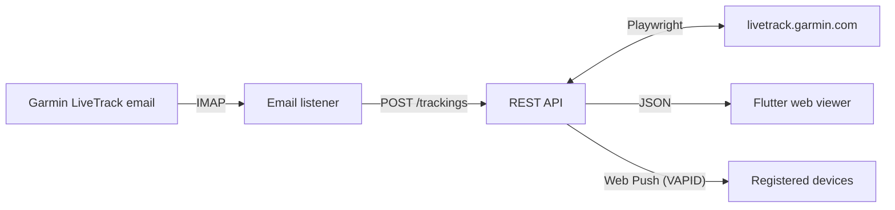

<p align="center">
  
</p>

<h1 align="center">GarminLiveTrack Server</h1>

<p align="center">
  <strong>Self-hosted Garmin LiveTrack, without Garmin's share page.</strong><br>
An email listener auto-starts tracking sessions from incoming Garmin emails, a REST API manages concurrent sessions, and a Flutter web viewer shows the live map with push notifications to registered devices.
</p>

<p align="center">
  <a href="https://github.com/Johannes11833/GarminLiveTrack-Server/releases/latest">
    
  </a>
  <a href="https://github.com/Johannes11833/GarminLiveTrack-Server/actions/workflows/publish-docker.yml">
    
  </a>
  
  
  
</p>

<p align="center">
  <a href="#demo">Demo</a> ·
  <a href="#highlights">Highlights</a> ·
  <a href="#how-it-works">How it works</a> ·
  <a href="#quick-start">Quick start</a> ·
  <a href="#livetrack-rest-api">REST API</a> ·
  <a href="#web-viewer--push-notifications">Viewer &amp; push</a> ·
  <a href="#example-env-file">Configuration</a>
</p>

---

## Demo

<table align="center">
  <tr>
    <td align="center">
      <br/>
      <sub>Mobile: live map with route, distance, speed and elevation</sub>
    </td>
    <td align="center">
      <br/>
      <sub>Mobile: heart rate graph expanded from the session card</sub>
    </td>
  </tr>
</table>

<p align="center">
  <br/>
  <sub>Desktop: live map and session card with heart rate, speed and elevation graphs side by side</sub>
</p>

## Highlights

- 🧵 **Multiple riders at once** — every session runs in its own Playwright worker, so concurrent sessions don't step on each other.
- 🗺️ **Live Flutter viewer** — full-screen map, route, distance, speed, elevation and heart-rate charts, responsive from phone to desktop.
- 🔔 **Push without Firebase** — standard Web Push (VAPID) sends "started" and "ended" notifications that deep-link straight into the session.
- 🧪 **Dummy mode** — simulate a five-minute session with synthetic data to try the UI without a Garmin link.
- 🐳 **Multi-arch images** — API, listener and viewer ship as `linux/amd64` and `linux/arm64` containers.

## How it works



## Quick start

**Prerequisite:** Docker with Compose v2.

```bash
git clone https://github.com/Johannes11833/GarminLiveTrack-Server.git
cd GarminLiveTrack-Server

# create .env with at least your IMAP credentials (see Example .env file below)
docker compose up -d --build
```

Open the viewer at `https://localhost/?id=<session id>&sessionToken=<garmin token>`
and add `&token=<push token>` to enable notifications. To try it without a real
Garmin link, set `LIVETRACK_ENABLE_DUMMY_MODE=1` in `.env`; a simulated session
starts automatically and the API logs a ready-to-open viewer URL.

## Docker Setup
### Docker compose setup

First setup your .env file as described below. Then start the compose project
(use `--build` to build the image from the local source instead of pulling it):

```bash
docker compose up -d --build
```

The email listener watches the configured mailbox and automatically starts a
tracking session through the API for every received Garmin LiveTrack link.
Registered devices then receive push notifications (see "Web viewer & push
notifications" below).

### Container images

Prebuilt images are published to GitHub Container Registry for `linux/amd64`
and `linux/arm64`, tagged both `latest` and the release version:

| Image                                                                                                                                                             | Purpose                            |
| ----------------------------------------------------------------------------------------------------------------------------------------------------------------- | ---------------------------------- |
| [`ghcr.io/johannes11833/garmin-livetrack-api`](https://github.com/Johannes11833/GarminLiveTrack-Server/pkgs/container/garmin-livetrack-api)                       | FastAPI + Playwright tracking API  |
| [`ghcr.io/johannes11833/garmin-livetrack-email-listener`](https://github.com/Johannes11833/GarminLiveTrack-Server/pkgs/container/garmin-livetrack-email-listener) | IMAP listener that starts sessions |
| [`ghcr.io/johannes11833/garmin-livetrack-viewer`](https://github.com/Johannes11833/GarminLiveTrack-Server/pkgs/container/garmin-livetrack-viewer)                 | Flutter web viewer served by nginx |

Use `docker compose up -d --build` to build everything locally, or
`docker compose pull` to grab the latest published images.

### Run livetrack bot w/o a container

```bash
# terminal 1: API
poetry run garmin-livetrack-api

# terminal 2: email listener (feeds URLs into the API)
poetry run garmin-livetrack-email-listener
```

### Extract LiveTrack data

Garmin blocks direct API clients, so the extractor uses Chromium to make
same-origin API requests. Install the dependency and browser once, then pass a
LiveTrack share URL:

```bash
poetry install
poetry run playwright install chromium
poetry run python garmin_livetrack/playwright_livetrack.py "https://livetrack.garmin.com/session/<id>/token/<token>"
```

The extractor writes `session.json`, `track.json`, and (when available)
`course.json` in `garmin_livetrack/`. Press `Ctrl+C` to stop polling.

### LiveTrack REST API

Run the independent multi-session API with:

```bash
poetry install
poetry run playwright install chromium
poetry run garmin-livetrack-api
```

Starting and stopping a tracking session requires the shared `LIVETRACK_API_TOKEN`
(see below):

```bash
curl -X POST http://127.0.0.1:8000/trackings \
  -H "Content-Type: application/json" \
  -H "Authorization: Bearer <the api token>" \
  -d '{"url":"https://livetrack.garmin.com/session/<id>/token/<token>"}'
```

Each session has its own Playwright worker and can run alongside other sessions.

To try the viewer UI without a real Garmin LiveTrack link, enable dummy mode
(`LIVETRACK_ENABLE_DUMMY_MODE=1` in `.env`). A simulated session then starts
automatically 5 seconds after the API comes up -- it walks a synthetic route
with fake speed/elevation/heart-rate data for 5 minutes, then ends itself.
The API logs the session id and token it started, e.g.:

```
[dummy] Started simulated session: id=<id> token=<token>
[dummy] Open the viewer with: ?id=<id>&sessionToken=<token>
```

- `GET /trackings` lists all tracking sessions (also requires the API token).
- `GET /trackings/{session_id}/token/{token}` returns a session's status and counts.
- `GET /trackings/{session_id}/token/{token}/track` returns accumulated track points.
- `GET /trackings/{session_id}/token/{token}/course` returns the current planned course.
- `GET /trackings/{session_id}/token/{token}/profile-image` returns the user's profile photo.
- `POST /trackings/{session_id}/token/{token}/message` sends a spectator message.
- `DELETE /trackings/{session_id}` requests that session stop (also requires the API token).

Trackers live in memory only (nothing persists across a restart) and are
swept periodically so the process doesn't accumulate them forever: a
finished session (stopped/ended/error) is dropped after
`LIVETRACK_TRACKER_RETENTION_SECONDS` (default 1 day); a tracker still
running past `LIVETRACK_TRACKER_MAX_AGE_SECONDS` (default 2 days) is force-
stopped and dropped as a safety net against a stuck worker. The sweep itself
runs every `LIVETRACK_TRACKER_CLEANUP_INTERVAL_SECONDS` (default 15 minutes).

Every per-session read/write endpoint above (except starting/stopping) requires
the Garmin session's own share token (the `<token>` from the original
`livetrack.garmin.com/session/<id>/token/<token>` URL) as a path segment,
mirroring Garmin's own URL shape, so knowing/guessing a session id alone isn't
enough to read or interact with someone's live location -- the viewer passes
this automatically from its `?sessionToken=` URL parameter (see below).

Interactive OpenAPI documentation is available at `http://127.0.0.1:8000/docs`.

### Web viewer & push notifications

The viewer in `garmin_livetrack_viewer/` is a Flutter web app that shows a
tracking session and can receive push notifications when a session starts or
ends. It uses the standard Web Push API (VAPID), no Firebase or other
third-party push service.

`docker compose up -d --build` builds and serves the viewer automatically
(`Dockerfile.viewer`, reverse-proxied by Caddy). To build it by hand instead
(the `API_BASE_URL` dart-define is optional; when empty the app talks to the
same origin as the page):

```bash
cd garmin_livetrack_viewer
flutter build web
```

VAPID keys are generated automatically on first start and stored in
`garmin-livetrack-data/vapid_keys.json`. You can override them (and set a
contact email for the push service) via the environment:

```
LIVETRACK_VAPID_PUBLIC_KEY = "..."
LIVETRACK_VAPID_PRIVATE_KEY = "..."
LIVETRACK_VAPID_CONTACT_EMAIL = "mailto:you@example.com"
```

### Registration token

Only people who know the shared registration token can subscribe. Set it via
the environment (generate one with e.g. `openssl rand -hex 32`):

```
LIVETRACK_PUSH_TOKEN = "...."
```

A visitor subscribes by opening the viewer with the token in the URL and
tapping the bell icon in the app bar:

```
https://livetrack.example.com/?id=<session id>&token=<the push token>&sessionToken=<the garmin token>
```

`token` is the push-registration token above; `sessionToken` is the Garmin
LiveTrack share token, required for the viewer to load anything for that
session at all (see "LiveTrack REST API") -- without it the app just shows
"Tracking not found." The bell icon is only shown when a push token is present
in the URL. All registered devices receive a notification for every session
that starts or ends ("LiveTrack started" / "LiveTrack ended", with the session
name as body); the notification carries the session's Garmin token too, so
tapping it opens the viewer with both parameters already set.

Deploy with HTTPS: service workers and Web Push require a secure context. The
included `Caddyfile` serves the built viewer and proxies the API
(`/trackings`, `/push`) on the same origin.

**Option A: Cloudflare Tunnel (recommended, no open inbound ports)**

1. In the Cloudflare Zero Trust dashboard, go to Networks > Tunnels > Create
   a tunnel (Cloudflared connector), then add a Public Hostname pointing at
   `http://caddy:80`.
2. Put the tunnel token in `.env`:
   ```
   CLOUDFLARE_TUNNEL_TOKEN = "..."
   ```
3. Run:
   ```bash
   docker compose up -d
   ```

Cloudflare terminates HTTPS at its edge and forwards plain HTTP to Caddy
through the tunnel, so no domain/certificate setup is needed on the server,
and ports 80/443 don't need to be open on your firewall at all.

**Option B: expose Caddy directly**

Replace the `:80 { import routes }` block in `Caddyfile` with your own
domain, so Caddy obtains its own Let's Encrypt certificate:

```
livetrack.example.com {
	import routes
}
```

Then point that domain's DNS at the server, open ports 80/443, and run
`docker compose up -d` (without `CLOUDFLARE_TUNNEL_TOKEN` set, the
`cloudflared` service will just fail to start and restart-loop harmlessly;
remove it from `compose.yml` if you don't need it).

Notes:
- On iOS (16.4+), push works only after the app is installed ("Add to Home
  Screen"); the permission prompt then comes from a user tap.
- Notifications require HTTPS on all supported browsers; the button shows a
  hint when the app is not in a secure context.

### Example .env file
```
LIVETRACK_EMAIL_HOST = "imap.gmx.net"
LIVETRACK_EMAIL_USERNAME = "email123@gmx.de"
LIVETRACK_EMAIL_PASSWORD = "ur-password"

LIVETRACK_PUSH_TOKEN = "change-me"

# shared secret required to start/stop tracking sessions (POST/DELETE
# /trackings); generate one with e.g. `openssl rand -hex 32`
LIVETRACK_API_TOKEN = "change-me-too"

# optional: where the email listener finds the API
# (default http://127.0.0.1:8000; compose sets it to the api service)
LIVETRACK_API_URL = "http://127.0.0.1:8000"

# optional: set to "1" to auto-start a simulated tracking session 5s after
# the API boots, for UI testing without a real Garmin LiveTrack link
# (off by default)
LIVETRACK_ENABLE_DUMMY_MODE = "1"

# optional: tracker cleanup sweep (see "LiveTrack REST API" above for what
# each one does); defaults shown here
LIVETRACK_TRACKER_CLEANUP_INTERVAL_SECONDS = "900"
LIVETRACK_TRACKER_RETENTION_SECONDS = "86400"
LIVETRACK_TRACKER_MAX_AGE_SECONDS = "172800"

# optional: only needed if using the cloudflared service to expose the app
# via a Cloudflare Tunnel instead of exposing Caddy directly (see README)
CLOUDFLARE_TUNNEL_TOKEN = "..."
```

---

<p align="center">
  <sub>Built with FastAPI, Playwright and Flutter. Not affiliated with Garmin.</sub>
</p>
